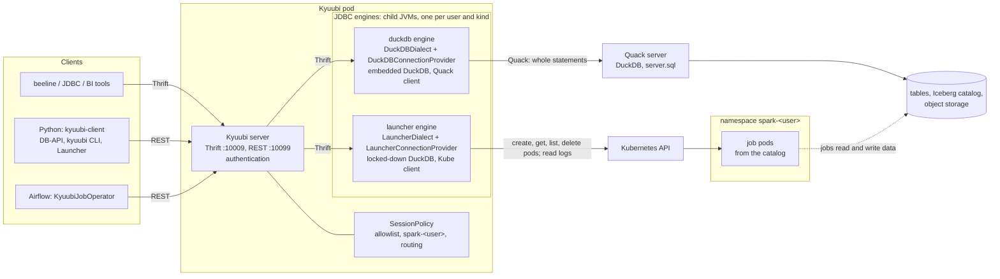
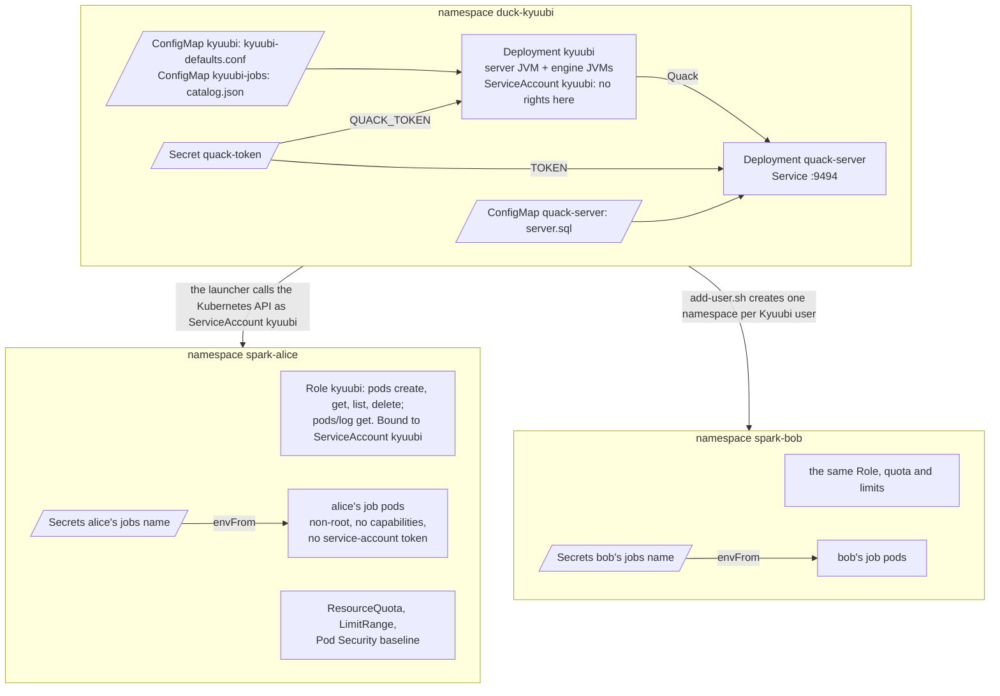
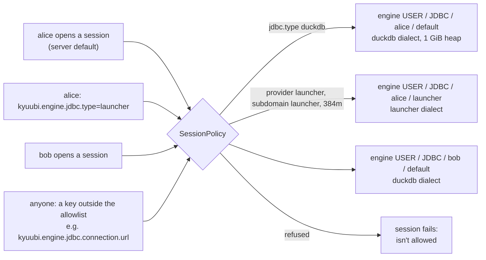
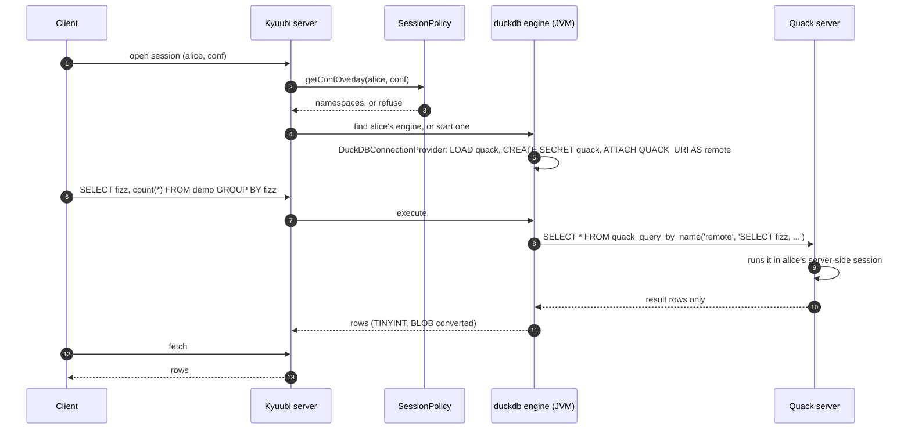
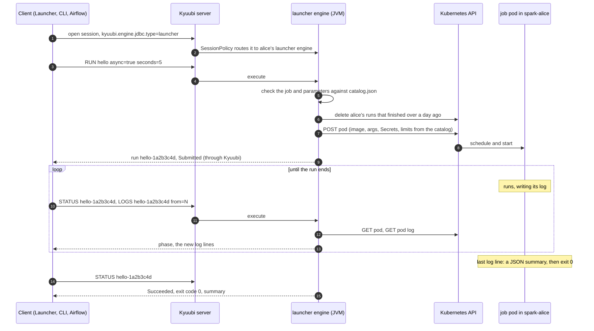

# Architecture

How the pieces fit together: who talks to whom, where each piece runs, which configuration each one reads,
and what happens on a query and on a job. GitHub renders the diagrams; anything that renders Mermaid will.

## The touch points

| Piece | Runs | What it does | Source |
|---|---|---|---|
| Clients | anywhere | beeline and JDBC over Thrift; the Python client, `kyuubi` CLI and Airflow operator over REST | [python](../python) |
| Kyuubi server | Kyuubi pod | logins, sessions, the REST and Thrift APIs; starts and finds engines | Apache Kyuubi 1.12.0 |
| Session policy | in the server | checks each session's config, names the user's namespace, routes launcher sessions | [kyuubi-session-policy](../kyuubi-session-policy) |
| duckdb engine | a JVM in the Kyuubi pod, per user | Kyuubi's JDBC engine with the duckdb dialect: ships each statement to the Quack server | [kyuubi-duckdb](../kyuubi-duckdb), [docs/duckdb.md](duckdb.md) |
| launcher engine | a JVM in the Kyuubi pod, per user | Kyuubi's JDBC engine with the launcher dialect: catalog jobs as pods | [kyuubi-launcher](../kyuubi-launcher), [docs/launcher.md](launcher.md) |
| Quack server | its own pod | DuckDB serving every user's SQL over Quack | [quack-server](../quack-server) |
| Job pods | the user's namespace | one per run; any image, following the job contract | [examples/jobs](../examples/jobs) |

## Configuration touch points

| What | Read by | Set in the examples | Controls |
|---|---|---|---|
| `kyuubi-defaults.conf` | the server, which passes it on to engines | ConfigMap `kyuubi`, or `examples/local/run-kyuubi.sh` | default engine and dialect, the engines' classpath, the session policy, authentication |
| Session config | the session policy, then the engine | JDBC URL (`;#key=value`), REST `configs`, `kyuubi --conf` | engine type, dialect (`duckdb` or `launcher`), Spark sizing; nothing outside the allowlist |
| `QUACK_URI`, `QUACK_TOKEN` | the duckdb engine (inherited from the server's environment) | Deployment `kyuubi`, Secret `quack-token` | which Quack server, and its token |
| `LAUNCHER_CATALOG` (`catalog.json`) | the launcher engine, on every statement | ConfigMap `kyuubi-jobs` | the jobs: images, commands, Secrets, parameters and their limits |
| `server.sql`, `TOKEN` | the Quack server, at start | ConfigMap `quack-server`, Secret `quack-token` | the data or catalog it serves, its lockdown, the token clients need |
| Namespace `spark-<user>` | Kubernetes | `examples/kubernetes/add-user.sh` | what Kyuubi may do there (a Role), quotas, Pod Security, the Secrets jobs get |
| `KYUUBI_USER`, `LAUNCHER_RUN`, `DUCKDB_MEMORY_LIMIT`, `DUCKDB_THREADS` | job containers | set by the launcher on each run | who started the run, which run it is, DuckDB's sizing |

## Where it runs on Kubernetes

Kyuubi's service account has no rights in its own namespace and only what the Role grants in each user's
namespace. Job pods get no service-account token at all. The JDBC engines aren't pods: Kyuubi's JDBC engine
has no Kubernetes deploy mode, so they run as child JVMs in the Kyuubi pod, which is why they only relay.

## Which engine a session gets

Kyuubi keys engines by share level, engine type, user and subdomain, not by dialect, so the session policy
gives launcher sessions a subdomain of their own. Each user's sessions of one kind share an engine; users
never share one (`kyuubi.engine.share.level=USER`).

## A query, step by step

Each Kyuubi session is one DuckDB session on the server, so temp tables and transactions carry over between
its statements. The engine's own DuckDB holds no data.

## A job, step by step

The client polls, so no request stays open for the length of a job; `RUN` without `async=true` instead holds
the statement until the pod ends.

## What crosses each boundary

| From → to | Carries | Limited by |
|---|---|---|
| Client → Kyuubi | user name and password, SQL or launcher commands, session config | Kyuubi's authentication; the session policy's allowlist |
| Kyuubi → engine | the statement, the session's config | the policy's overlay (it wins over the client's) |
| duckdb engine → Quack server | whole statements, the token | the token; the server's lockdown (no local files, locked settings) |
| launcher engine → Kubernetes API | pods built from the catalog, with Kyuubi's service-account token | the Role in `spark-<user>`; the catalog; the parameters' limits |
| Job pod → the rest | whatever its image does, with the Secrets the catalog names | the namespace's quota and Pod Security; no service-account token |
